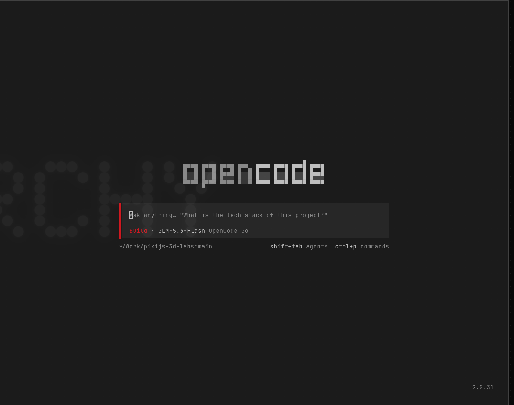
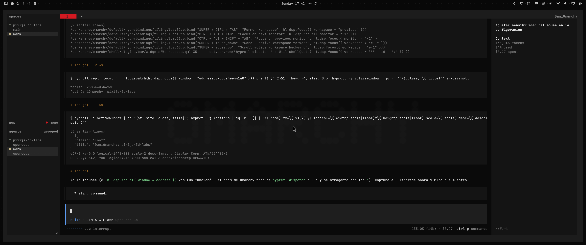
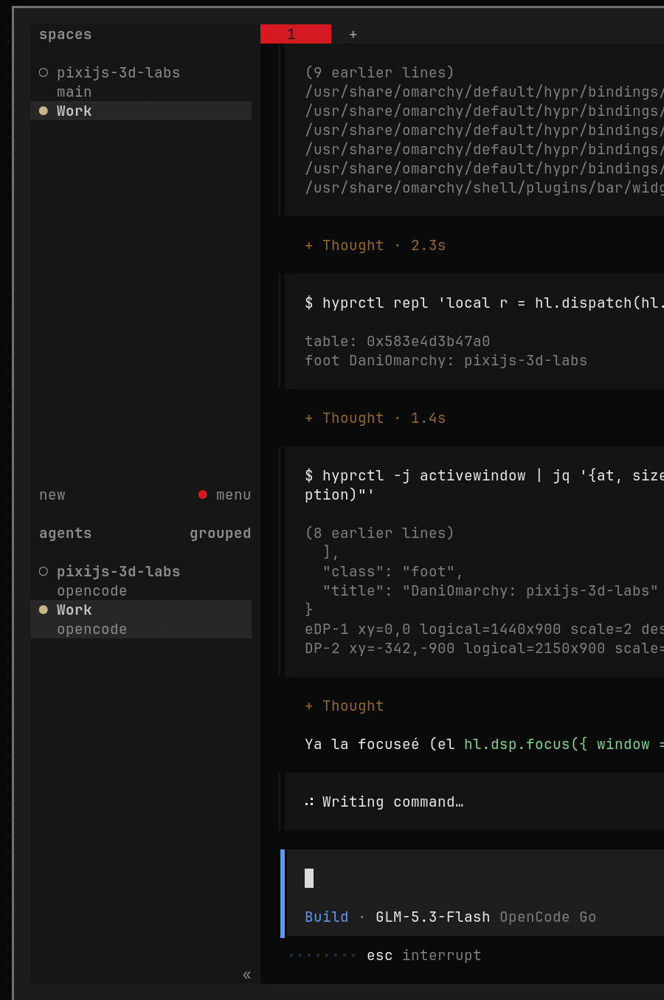

# nothing-dark-configs

OpenCode + Herdr configurations matched to the **Nothing** design language
(Nothing OS — graphite, silver text, one loud red `#D71921`).

Designed to pair with the Nothing Dark Omarchy desktop theme
([xvvhang/omarchy-nothing-dark-theme](https://github.com/xvvhang/omarchy-nothing-dark-theme)):
same_background (`#1C1C1C`), text (`#C6C6C6`), border (`#747474` / `#414141`)
and accent red (`#D71921`).

## Palette

| Role | Color |
| --- | --- |
| Background | `#1C1C1C` |
| Deeper / deepest surface | `#161616` / `#101010` |
| Raised surface | `#282828` |
| Foreground | `#C6C6C6` |
| Muted text | `#8E8E8E` |
| Active / inactive border | `#747474` / `#414141` |
| Brand / interaction accent | `#D71921` |

## Contents

```
opencode/
├── cli.json                   # CLI/TUI settings: theme = nothing-dark, mode dark
└── themes/
    └── nothing-dark.json      # Custom theme (dark graphite + light silver mode)
herdr/
└── config.toml                # vesper base theme restyled with Nothing tokens
```

## Screenshots

OpenCode (home) with the `nothing-dark` theme — dot-matrix splash, red `#D71921`
prompt accent on graphite:



OpenCode running inside Herdr (both tools themed together):



Herdr sidebar — spaces and agents with the red workspace accent:



## Install — OpenCode

```sh
mkdir -p ~/.config/opencode/themes
cp opencode/themes/nothing-dark.json ~/.config/opencode/themes/
cp opencode/cli.json ~/.config/opencode/cli.json   # merge theme.name into yours
```

Then run `/themes` in the TUI to switch (it reloads live) and pick `nothing-dark`.
The theme ships both modes: dark = graphite, light = the satin-aluminium
companion palette.

## Install — Herdr

```sh
cp herdr/config.toml ~/.config/herdr/config.toml   # or merge the [theme] section
herdr config check
herdr server reload-config
```

Themes are client-side: an already-attached TUI picks the new theme up on
reattach. The base theme is the built-in `vesper` with a `[theme.custom]` token
overlay (panel/sidebar/active row/text/accent + desaturated state colors).
Keybindings and tmux-style layout tweaks are included; reset them if you only
want the colors.

## Notes

- Neither tool supports spelling the exact Nothing look out of the box, so
  these are "close as the tooling allows":
  - OpenCode classic-theme JSON (full token control: diff, markdown, syntax).
  - Herdr only exposes UI color tokens, so agent state dots use desaturated
    greens/blues to stay compatible with graphite.
- The matching wallpaper uses Nothing's Ndot 57 lettering — see the Omarchy
  theme repo above.

Unofficial, no affiliation with Nothing or Omarchy.
